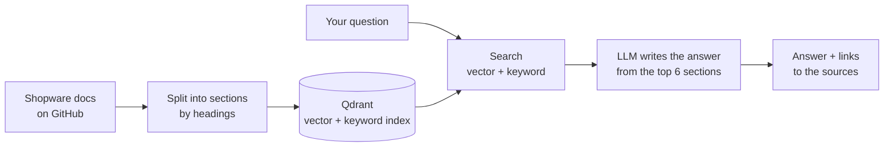

# Shopware 6 Docs RAG

Ask a question about Shopware 6 development and get an answer written **only from the official
documentation**, with a link to the exact section behind every claim. If the docs don't cover the
question, it says so instead of guessing.

## What it does

1. **Reads the official docs.** Downloads the Shopware developer documentation at a fixed version
   and splits each page into sections by its headings, without ever cutting a code example in half.
2. **Finds the right sections.** Combines meaning-based search (vector embeddings) with keyword
   search (BM25) in Qdrant.
3. **Writes a cited answer.** An LLM (Claude, OpenAI or a free local model) answers using only those
   sections and cites them as [1], [2], ... Citations that don't exist are removed.
4. **Measures itself.** A set of 47 test questions scores every design choice, so each decision is
   backed by a number.

## How it works



## Try it

You only need Docker.

```bash
cp .env.example .env            # pick the LLM: Claude (API key) or a free local model (Ollama)
docker compose up -d --build    # start the database and the API
make ingest                     # download the docs and build the index (~20 min)
```

Then open **<http://localhost:8000>**, type a question and click *Ask*. On Windows without `make`,
use `.\tasks.ps1 ingest`.

Example answer from the API:

```json
{
  "answer": "When the merchant chooses to keep the extension data, your uninstall method should not remove or delete any persistent data created by your plugin. Instead, you can return early from the `uninstall` method without performing any cleanup actions.",
  "citations": [
    {
      "n": 1,
      "title": "Plugin Lifecycle Methods",
      "url": "https://developer.shopware.com/docs/guides/plugins/plugins/plugin-fundamentals/plugin-lifecycle.html#keeping-user-data-upon-uninstall"
    }
  ]
}
```

## Results

Each row adds one change to the row above. Measured on 47 questions (42 answerable, 5 that the docs
don't cover), with a small local model writing the answers.

| Setup | Right page in top 5 | Ranking quality (MRR) | Answers backed by the sources | Time per answer |
|---|---|---|---|---|
| Fixed-size chunks + vector search | 95 % | 0.83 | 91 % | 5.4 s |
| + split by headings | 98 % | 0.87 | 94 % | 3.6 s |
| + keyword search (equal weight) | 100 % | 0.83 | 92 % | 3.9 s |
| + keyword search (half weight) | 100 % | 0.86 | 91 % | 3.0 s |
| + reranker | 98 % | 0.80 | 90 % | 4.5 s |

What I learned:

- **Splitting by headings helped the most.** Better ranking, more faithful answers, and 22 % fewer
  tokens sent to the LLM.
- **Not every textbook technique helps.** Equal-weight keyword search and the reranker made the
  ranking worse on this corpus. The default is vector search plus half-weight keyword search.
- **The small local model is the weak point.** It sometimes says "not found" even when the answer
  is in the first section. A stronger model such as Claude is the next thing to test.

The test set is small, so treat small differences as directional. Full numbers, failure examples
and design decisions are in **[docs/DESIGN.md](docs/DESIGN.md)**.

## Tech stack

Python 3.11 · FastAPI · Qdrant · fastembed (ONNX, no PyTorch) · Claude / OpenAI / Ollama ·
Docker Compose · uv · pytest

## Project structure

```
app/      API, search, answer generation
ingest/   download the docs, split them, build the index
eval/     test questions, metrics, results
tests/    unit and API tests (no network needed)
docs/     DESIGN.md (details) · UDHEZUES.md (study guide in Albanian)
```

## Limitations

- English questions only (the embedding model is English).
- 47 test questions are enough to compare ideas, not to prove small differences.
- A reference project, not a hosted service: no login or rate limiting.

## Data

The Shopware documentation belongs to shopware AG and is not included in this repository. It is
downloaded by `make ingest` from the official GitHub repository.
