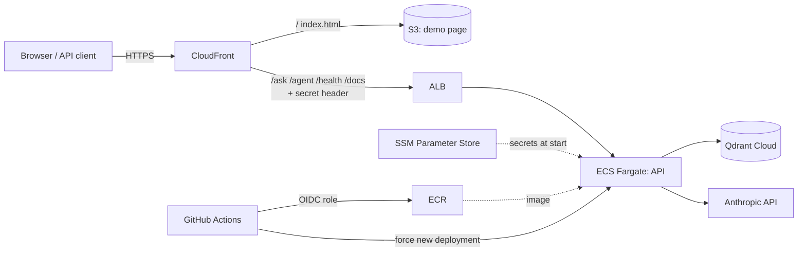

# AWS deployment (Terraform)

The API runs on **ECS Fargate** behind an **Application Load Balancer**, with **CloudFront** as the
single HTTPS entry point. The demo page is served from a private **S3** bucket. The image lives in
**ECR**, secrets in **SSM Parameter Store**, and **GitHub Actions** deploys through **OIDC**, so no
AWS keys are stored in GitHub. The vector index is a free **Qdrant Cloud** cluster in the same
region.



## Decisions

| Decision | Why |
|---|---|
| Public subnets, no NAT gateway | The task needs outbound internet (ECR, Anthropic, Qdrant, model downloads). A NAT gateway costs ~$35/month on its own; a public IP on the task does the same. Inbound stays closed by security groups. |
| ALB reachable only from CloudFront | Security group allows only the AWS-managed CloudFront origin prefix list, and a listener rule forwards only requests with a secret `X-Origin-Verify` header that CloudFront adds. Anything else gets 403. |
| CloudFront in front of everything | Free HTTPS on `*.cloudfront.net` without a domain or certificate, one origin for page and API (no CORS), and `/ingest` is simply not routed. |
| `X-API-Key` on `/ask` and `/agent` | Both spend LLM tokens. The key is generated by Terraform (`terraform output -raw api_key`); `/health`, `/docs` and the page stay public. |
| Third-party secrets outside Terraform | Terraform creates the SSM parameters with a placeholder and ignores their value; you set the real keys once with the AWS CLI. They never appear in code or in the state file. |
| GitHub OIDC deploy role | Short-lived credentials, scoped to this repository's `main` branch, and allowed only to push this image, restart this service and update this page. |
| ALB health check on `/docs` | `/health` returns 503 when an upstream (LLM key, Qdrant) is wrong; that should show up in monitoring, not make ECS kill healthy containers in a loop. |
| Circuit breaker with rollback | A new image that never becomes healthy is rolled back automatically. |
| Account budget with email alerts | 50% actual and 100% forecast of `monthly_budget_usd`. |

## Cost

Roughly $2 per day while running in `eu-central-1` with the defaults: the Fargate task (0.5 vCPU /
2 GB), the load balancer and three public IPv4 addresses make up nearly all of it. S3, CloudFront,
ECR, CloudWatch and SSM stay in the cents. Anthropic usage is billed separately, at about $0.001
per `/ask` and $0.003 per `/agent` question with `claude-haiku-5-5` (see `docs/DESIGN.md`).
**Run it while you need it and `terraform destroy` afterwards.**

## Deploy

Needs: an AWS account with credentials for Terraform (`aws configure`), Terraform >= 1.10, the AWS
CLI, Docker, and a free Qdrant Cloud cluster in `eu-central-1` (URL + API key).

```bash
# 1. Index the docs into Qdrant Cloud (from your machine, ~7 min)
docker compose run --rm -e QDRANT_URL=<cluster url> -e QDRANT_API_KEY=<key> api python -m ingest --chunking heading

# 2. Repository and secret parameters first
cd infra
cp terraform.tfvars.example terraform.tfvars        # set alert_email and qdrant_url
terraform init
terraform apply -target=aws_ecr_repository.api -target=aws_ssm_parameter.external

# 3. Real secret values (never stored in Terraform)
aws ssm put-parameter --overwrite --type SecureString --name /shopware-docs-rag/LLM_API_KEY    --value <anthropic key>
aws ssm put-parameter --overwrite --type SecureString --name /shopware-docs-rag/QDRANT_API_KEY --value <qdrant key>

# 4. First image (Windows: .\push-image.ps1; later pushes come from GitHub Actions)
# 5. Everything else
terraform apply
terraform output url
terraform output -raw api_key
```

Then set the values of `terraform output github_variables` as repository variables (GitHub →
Settings → Secrets and variables → Actions → Variables). From then on every push to `main`
builds, pushes and rolls out the new image and publishes the page.

**Tear down:** `terraform destroy` (Qdrant Cloud and the Anthropic key are not touched).
